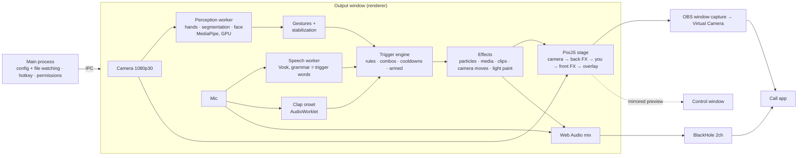

# Skillcam

**Say a word or make a gesture, and your camera feed reacts, live, in any video call.**

Skillcam is a macOS app that watches your webcam and listens to your mic, recognizes hand gestures and a few spoken trigger words, and draws effects on your video in real time: confetti from your fist, a fireball in your palm, an explosion *behind* you, curtains closing when you say "bye". The result goes into FaceTime, WhatsApp, Zoom, Meet or Discord through OBS Virtual Camera, with your voice and the effect sounds mixed into the call.

Everything runs locally. No video or audio is recorded, uploaded or sent anywhere except into the call you choose.

<!-- SCREENSHOT/GIF: hero demo, e.g. "boom" → explosion behind you in a FaceTime call (docs/media/hero.gif) -->
> 📸 *Hero GIF goes here.*

## Features

- **15 hand gestures**: MediaPipe's built-in ones plus custom ones from hand geometry (Rock, Finger gun, Finger heart, Pinch, Palm push, Pray, Clap, Both hands up).
- **Voice triggers** with an offline speech model restricted to your trigger words, plus decoy words so similar-sounding speech doesn't fire them.
- **Combos**: a word plus a gesture within a time window ("fire" + open palm).
- **Effects behind you**: person segmentation cuts you out, so clips can play between the room and you.
- **Your own reactions**: drop images, GIFs, videos (green screen is keyed automatically) or sounds into a folder and map them in one line of JSON. Changes apply without a restart.
- **Light painting**: pinch and draw glowing lines in the air.
- **Sound into the call**: effect sounds and your voice go to the call through BlackHole.
- **Control panel**: arm/disarm, health of camera, tracking, speech and call audio, live preview, a Test button and an on/off switch per effect.
- **Global hotkey** (⇧⌘K) to arm or disarm from inside the call app. The other side never sees the panel.
- **Built for frame time**: tracking runs in a worker, quality adapts under load, and the output holds 60 fps at 1080p.

<!-- SCREENSHOT: the Control panel (docs/media/control.png) -->
> 📸 *Control panel screenshot goes here.*

## Gestures and words

The default mapping (`skillcam.config.json`):

| Trigger | Effect |
|---|---|
| 👍 Thumbs up | Reaction image in a corner |
| 👎 Thumbs down | Reaction image in a corner |
| ✌️ Victory | Reaction image in a corner |
| ✊ Fist (each hand) | Confetti bursts out of that hand |
| 🤘 Rock | Rock GIF + guitar riff |
| 🫶 Finger heart (two hands) | Hearts float up between your hands |
| 👉 Finger gun | Reaction image in a corner |
| 🤏 Pinch (each hand) | Light painting while you pinch |
| ☝️ Pointing up | Reaction image in a corner |
| 🙌 Both hands up | Reaction GIF |
| 👏 Clap (camera *and* clap sound) | Clapping clip |
| 🙏 Pray | Reaction GIF |
| "fire" + ✋ open palm | Fireball that follows your palm |
| "boom" | Full-screen explosion behind you + camera shake |
| "let's go" | Celebration clip with sound |
| "I love you" | Full-screen floating hearts |
| "bye" (at the end of a sentence) | Curtains close |

<!-- GIF: a montage of a few effects (docs/media/effects.gif) -->
> 📸 *Effects montage goes here.*

## Performance

Measured on a MacBook Air (Apple M5), 1080p camera and output, call audio on:

| | |
|---|---|
| Output | **60 fps** at 1920×1080 (budget: never below 30 fps, including in a call) |
| Main-thread work per frame | **0.1–0.2 ms** (dev and packaged app alike) |
| GPU render cost per frame | 0.15 ms (camera only) to 0.5 ms (everything on) |
| Gesture → effect on screen | **~125 ms** (Fist) / **~160 ms** (others, incl. a deliberate 100 ms hold) |
| Hand tracking result | 13–20 ms per frame, in a worker |
| Word → effect | ~0–300 ms from partial results; ~0.8–1 s for words that wait for the end of the phrase ("bye", "I love you") |
| Mic → call app | **~20 ms** through BlackHole |
| Long tasks on the main thread | 0 |

OBS, the virtual camera and the call app add their own latency after Skillcam.

## How it works



- **One renderer process drives both windows.** The Output page owns the camera, tracking, triggers, effects and the stage. It opens the Control window itself and draws a downscaled copy of its canvas into it. One camera, one tracker, no per-frame IPC.
- **Perception runs in a Web Worker.** Each camera frame goes over as a transferred `VideoFrame`. At most one frame is in flight, so a busy worker skips frames instead of queuing them. Hand results are posted before segmentation and face detection run. Rendering never waits: it uses the latest result, with hand positions predicted in between.
- **Render layers**: camera (colour grade in its shader) → effects behind you → you, cut out by the segmentation mask → effects in front → overlays.
- **Adaptive quality** raises the tracking stride, lowers particle counts and caps the frame rate under load, and recovers when the load falls.

More detail: [BUILD_PLAN.md](BUILD_PLAN.md) (architecture and decisions) and [PROGRESS.md](PROGRESS.md) (what was measured, phase by phase).

## Install

Requirements: a Mac with Apple Silicon (tested on macOS 26). For calls: [OBS Studio](https://obsproject.com) and [BlackHole 2ch](https://existential.audio/blackhole/).

### From the .dmg

1. Open `Skillcam-<version>-arm64.dmg` and drag **Skillcam** to Applications.
2. **First launch:** the app isn't signed with an Apple Developer ID, so macOS blocks a normal double-click the first time.
   - Right-click (or Control-click) Skillcam in Applications → **Open** → **Open**.
   - On macOS 15 and later, if there's no Open button: try to open it once, then go to System Settings → Privacy & Security, scroll down to "Skillcam was blocked…" and click **Open Anyway**.
   - Or in Terminal: `xattr -dr com.apple.quarantine /Applications/Skillcam.app`
3. Allow camera and microphone access when asked.

After that it opens normally. An app you build yourself on your own Mac isn't quarantined, so step 2 usually doesn't apply.

### Build from source

```sh
git clone https://github.com/gabercmatej/skillcam-real-time-gesture-recognition.git
cd skillcam-real-time-gesture-recognition
npm install
npm run fetch-assets   # MediaPipe + Vosk models (~80 MB, once)
npm run dev            # run from source
npm run dist           # → release/Skillcam-<version>-arm64.dmg and release/mac-arm64/Skillcam.app
```

`npm test` runs the unit tests and `npm run typecheck` the TypeScript check. `npm run icon` regenerates the app icon from `build/icon.svg`.

## Use it in a call

1. **Video:** in OBS, add a macOS Screen Capture source → Window Capture → **Skillcam Output**, and click **Start Virtual Camera**. In the call app, pick **OBS Virtual Camera** as the camera. Full guide: [docs/obs-setup.md](docs/obs-setup.md).
2. **Audio:** install BlackHole 2ch (`brew install blackhole-2ch`, then restart the Mac or run `sudo killall coreaudiod`). In the call app, pick **BlackHole 2ch** as the microphone. Skillcam sends your voice plus effect sounds there. Use headphones. Full guide: [docs/audio-setup.md](docs/audio-setup.md).
3. Press **⇧⌘K** to arm or disarm from anywhere. The Control window shows the state. The other side never sees it.

## Configure

The app keeps everything you can edit in one folder. The Control panel's **Show in Finder** button opens it.

| | Config and reactions |
|---|---|
| Packaged app | `~/Library/Application Support/Skillcam/` |
| `npm run dev` | the project folder |

```
Skillcam/
├── skillcam.config.json   rules (trigger → effects) and effect definitions
├── reactions/             your images, GIFs, videos and sounds, one folder per reaction
└── effects/clips/         clips for "clip" effects
```

On first launch the app copies its defaults there. It never overwrites what you changed. Delete `skillcam.config.json`, `reactions/` or `effects/clips/` to get that default back on the next launch. Saving the config or changing files applies immediately, with no restart. If the config is invalid, the panel shows the error and keeps the last good version.

### Config format

```jsonc
{
  "hotkey": "CommandOrControl+Shift+K",
  "defaultCooldownMs": 2000,
  "words": ["fire", "boom", "let's go", "bye"],          // the speech grammar: only these can fire
  "rules": [
    { "when": { "gesture": "ThumbUp" }, "play": "thumbs_up" },
    { "when": { "gesture": "Fist" }, "play": "confetti_hand", "perHand": true, "cooldownMs": 700 },
    { "when": { "word": "boom" }, "play": ["explosion", "shake"], "cooldownMs": 4000 },
    { "when": { "gesture": "OpenPalm", "word": "fire", "withinMs": 1500 }, "play": "fire_palm" },
    { "when": { "word": "bye" }, "play": "curtains", "confirm": "final", "pauseAfterMs": 150 }
  ],
  "effects": {
    "thumbs_up":     { "type": "media", "files": "thumbs up" },
    "confetti_hand": { "type": "particles", "preset": "confetti", "anchor": "hand", "count": 120 },
    "explosion":     { "type": "media", "files": "boom", "placement": "fullscreen", "layer": "back" },
    "shake":         { "type": "cameraMove", "kind": "shake", "intensity": 0.8, "durationMs": 600 },
    "curtains":      { "type": "media", "files": "bye", "placement": "fullscreen" }
  }
}
```

**Rules.** `when` takes a `gesture`, a `word`, or both with `withinMs` (a combo). A combo cancels the solo rules on its triggers. Optional: `cooldownMs`, `perHand` (each hand fires on its own), `confirm` (`"partial"`: fire as soon as the word is heard, the default; `"final"`: wait for the end of the phrase), `minConfidence`, and `pauseAfterMs` (with `final`: the word must be followed by a pause, so "by tomorrow" doesn't fire "bye").

**Gestures:** `ThumbUp` `ThumbDown` `Victory` `OpenPalm` `Fist` `PointingUp` `Rock` `ILoveYou` `FingerGun` `Pinch` `PalmPush` `Heart` `Pray` `Clap` `BothHandsUp`

**Effect types:**

| `type` | What it does | Main options |
|---|---|---|
| `media` | Image, GIF, video or sound from `reactions/` | `files` (a folder or file, or a list), `placement` (`corner`, `anchor`, `fullscreen`), `layer` (`front`/`back`), `size`, `anchor`, `follow`, `holdMs`, `fadeMs`, `volume`, `muted` |
| `sound` | A sound from `reactions/` | `files`, `volume` |
| `particles` | Confetti, hearts or sparks | `preset`, `anchor`, `count` |
| `lightPaint` | Draw with a pinch | `color` (`"rainbow"` or `#rrggbb`), `width`, `fadeMs` |
| `cameraMove` | Shake, zoom or colour grade | `kind`, `intensity`, `amount`, `target` (`hand`, `face`, `center`), `saturation`, `tint`, `vignette`, `durationMs` |
| `clip` | A video from `effects/clips/` | `file`, `layer`, `anchor`, `scale`, `key` (green screen) |

**Anchors:** `hand` `between-hands` `face` `center` `bottom-corners` `top-left` `top-right` `bottom-left` `bottom-right` `bottom-center`

Other sections (`audio`, `video`, `speech`, `clap`, `performance`) have working defaults. See `src/shared/config.ts` for every option.

### Add or replace reactions

1. Click **Show in Finder** in the Control panel and open `reactions/`.
2. Drop files into the reaction's folder, e.g. another picture into `reactions/thumbs up/`. A folder with several files picks one at random each time.
   - Images: `.png` `.jpg` `.jpeg` `.webp` `.gif` (animated GIFs play)
   - Video: `.webm` `.mp4` `.m4v` `.mov`. A green background is detected and keyed out automatically.
   - Sound: `.mp3` `.wav` `.ogg` `.m4a` `.aac`
3. For a new reaction, make a folder and add an effect and a rule:
   ```json
   "rules":   [ { "when": { "gesture": "Victory" }, "play": "party" } ],
   "effects": { "party": { "type": "media", "files": "party", "size": 0.4 } }
   ```
4. Save. It works on the next trigger, with no restart. Use **Test** in the panel to try it without performing the gesture.

## Privacy

- Camera and microphone data stay in memory. Nothing is written to disk.
- The app makes no network requests. Remote origins are blocked by both the Content-Security-Policy and a request filter.
- All models (MediaPipe, Vosk) ship inside the app.

## Built with

- [Electron](https://www.electronjs.org) + [electron-vite](https://electron-vite.org) + TypeScript (strict)
- [MediaPipe Tasks Vision](https://ai.google.dev/edge/mediapipe/solutions/vision/gesture_recognizer): gesture recognizer, selfie segmenter, BlazeFace detector
- [Vosk](https://alphacephei.com/vosk/) via [vosk-browser](https://github.com/ccoreilly/vosk-browser): offline speech recognition (small English model)
- [PixiJS v8](https://pixijs.com): WebGL rendering, custom shaders for chroma key, grade and segmentation cutout
- Web Audio + AudioWorklets: clap onset detection, the call mix
- [zod](https://zod.dev): config validation
- [Vitest](https://vitest.dev): tests
- [electron-builder](https://www.electron.build): packaging
- [OBS Studio](https://obsproject.com) and [BlackHole](https://existential.audio/blackhole/) for getting it into calls

## License

<!-- LICENSE: to be chosen -->
Not chosen yet.

The media in `reactions/` are third-party memes and stock clips used as placeholders for a personal demo. They are not covered by this project's license. Replace them with your own.
