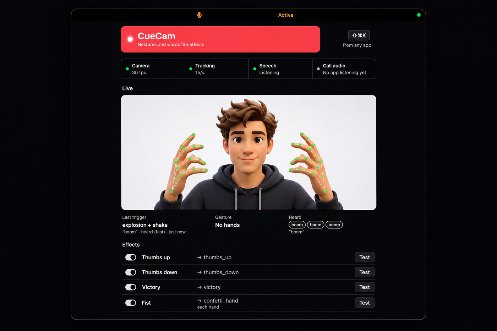
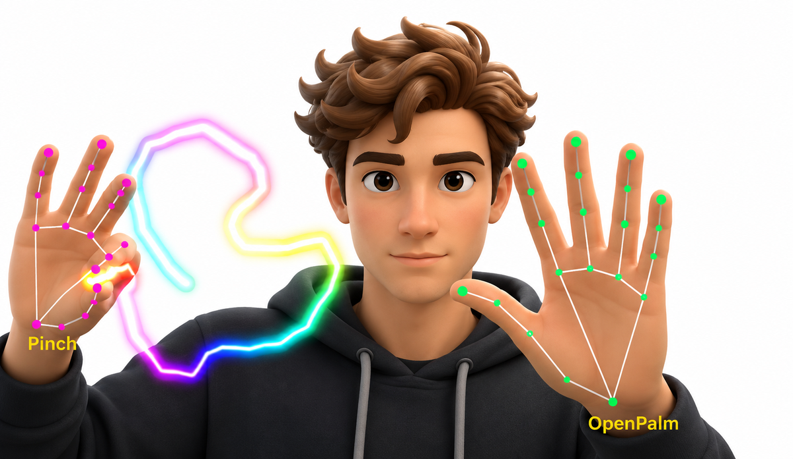
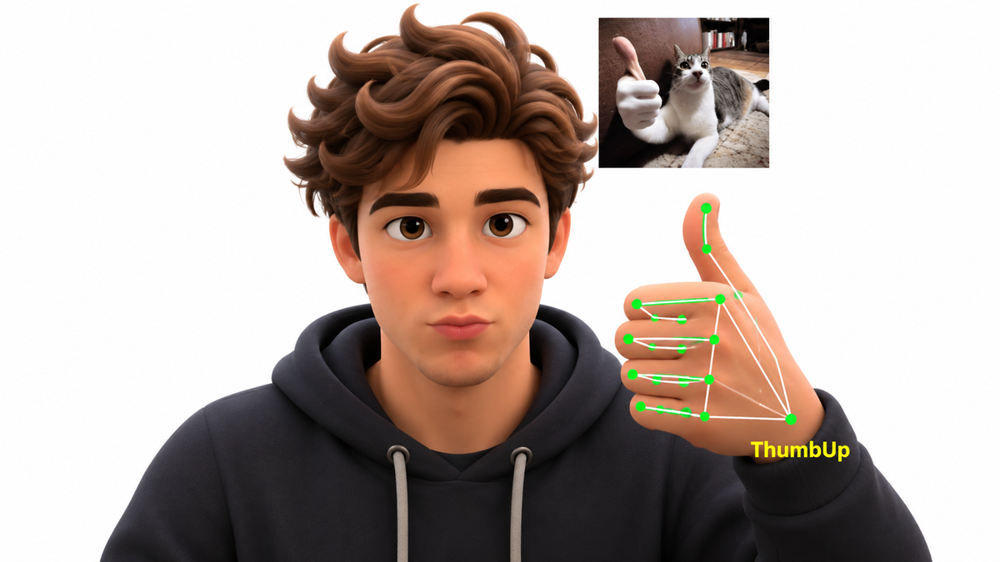
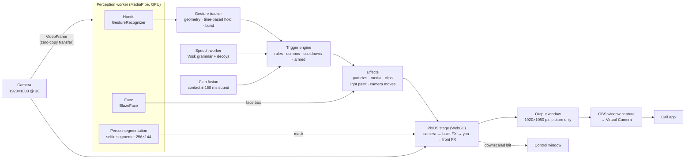
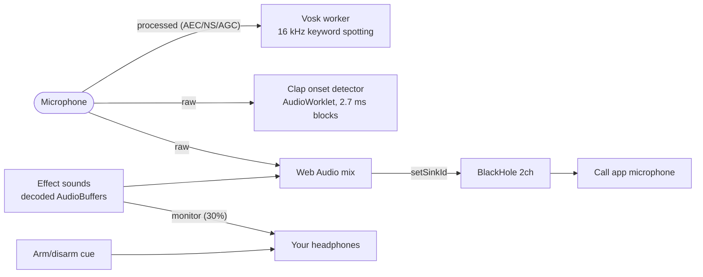

<div align="center">

# CueCam

**Real-time gesture and voice recognition that turns your webcam into a live effects engine for video calls.**

Make a gesture or say a word, and confetti, fireballs, explosions *behind* you and reaction clips appear on your video in about 150 ms. Fully offline, 60 fps at 1080p, into FaceTime, Zoom, Meet, WhatsApp or Discord.

[](https://gabercmatej.github.io/cuecam/)


[](LICENSE)

</div>

<p align="center">
  
</p>

<table>
<tr>
<td width="50%"></td>
<td width="50%"></td>
</tr>
<tr>
<td align="center"><sub><b>Light painting</b> · pinch to draw, both hands tracked at once</sub></td>
<td align="center"><sub><b>Reactions</b> · a recognised gesture fires a clip</sub></td>
</tr>
</table>

<p align="center"><sub>Control panel and gesture overlays, shown with a stylised demo avatar.</sub></p>

## Live demo

**[gabercmatej.github.io/cuecam](https://gabercmatej.github.io/cuecam/)** · Chrome or Edge on a laptop or desktop, nothing to install.

The same engine as the desktop app, running entirely in your browser tab: camera, hand tracking, segmentation, all visual effects and reactions, light painting, and (one click) voice triggers and clap. Toggle **"What the AI sees"** to watch the hand skeletons with their live gesture labels, the segmentation mask, the face box and the stats (keys H, M, F, S); K arms and disarms. Nothing is uploaded: models and media download once, then everything runs locally. How it's built: [docs/web-demo.md](docs/web-demo.md).

## Contents

- [What it does](#what-it-does)
- [Gestures and words](#gestures-and-words)
- [Architecture](#architecture)
- [Engineering deep-dives](#engineering-deep-dives)
- [Performance](#performance)
- [Setup](#setup)
- [Configuration](#configuration)
- [Tech stack](#tech-stack) · [Project structure](#project-structure) · [Testing](#testing)
- [Privacy](#privacy) · [License](#license)

## What it does

CueCam watches your webcam and listens to your mic, recognizes hand gestures and a small set of spoken trigger words, and composites effects onto your video in real time. A frameless Output window carries only the finished picture; OBS turns it into a virtual camera for any call app. Your voice and the effect sounds go into the call through a virtual audio device.

| | |
|---|---|
| ✋ **15 hand gestures** | MediaPipe's built-in gestures plus custom ones computed from hand geometry: Rock, Finger gun, Finger heart, Pinch, Palm push, Pray, Clap, Both hands up. Fist and Pinch work per hand. |
| 🗣️ **Voice triggers** | Offline keyword spotting with Vosk, restricted to your trigger words plus 334 decoy words so that similar-sounding speech lands on a decoy instead of firing an effect. |
| 🔗 **Combos** | A gesture plus a word within a time window ("fire" + open palm → fireball in your hand). A combo cancels the solo rules on its triggers. |
| 🧍 **Effects behind you** | Person segmentation cuts you out of the frame, so explosions and fire play between the room and you. |
| 🟩 **Chroma key** | Green-screen clips are detected and keyed automatically, per clip, by their own green. |
| 🌈 **Light painting** | Pinch and draw glowing rainbow lines in the air, with both hands at once. |
| 👏 **Clap = camera + sound** | A clap fires only when the camera sees your hands meet *and* the mic hears a clap transient within ±150 ms. |
| 🔊 **Call audio** | Your raw mic and the effect sounds are mixed in Web Audio and sent to the call through BlackHole (~20 ms). |
| 🎚️ **Arm / disarm** | A global hotkey (⇧⌘K) works from inside the call app. Disarming fades every running effect out within 250 ms. The other side never sees the state. |
| ♻️ **Hot reload** | Edit the JSON config or drop files into `reactions/`: changes apply on the next trigger, with no restart. An invalid config keeps the last good one and shows the error. |
| 🩺 **Control panel** | Armed state, a health strip (camera, tracking, speech, call audio) with reasons in plain words, live preview, last trigger and its cause, a Test button and an on/off switch per rule, per-stage timings. |

## Gestures and words

The default mapping (`skillcam.config.json`):

| Trigger | Effect |
|---|---|
| 👍 Thumbs up | Reaction image in a corner (random pick, never the same twice in a row) |
| 👎 Thumbs down | Reaction image in a corner |
| ✌️ Victory | Reaction image in a corner |
| ✊ Fist (each hand) | Confetti bursts out of that hand |
| 🤘 Rock | Rock GIF + guitar riff |
| 🫶 Finger heart (two hands) | Hearts float up between your hands |
| 👉 Finger gun | Reaction image in a corner |
| 🤏 Pinch (each hand) | Light painting while you pinch |
| ☝️ Pointing up | Reaction image in a corner |
| 🙌 Both hands up | Reaction GIF |
| 👏 Clap (camera *and* clap sound) | Clapping-cat clip with sound |
| 🙏 Pray | Reaction GIF |
| "fire" + ✋ open palm | A fireball that sits on your palm, follows it and scales with it |
| "boom" | Full-frame explosion **behind you** + camera shake |
| "let's go" / "yippie" | Celebration clip with sound |
| "I love you" | Full-frame floating hearts |
| "bye" (at the end of a sentence) | Curtains close over everything |

<!-- GIF: a montage of a few effects (docs/media/effects.gif) -->
## Architecture

### Video pipeline



- **One renderer process drives both windows.** The Output page owns the camera, the tracker, the trigger engine, the effects and the stage. It opens the Control window itself (`window.open`, same origin, same process) and blits a downscaled copy of its canvas into it. One camera, one tracker, no per-frame IPC.
- **The main process** owns the config file (zod-validated, watched), the `reactions/` folder (listed and watched), the global hotkey and macOS permissions, and serves media over a custom `skillcam://` protocol with paths confined to their folder.
- **Render layers:** camera (colour grade in its shader) → effects behind you → you, re-drawn with the segmentation mask as alpha → effects in front → vignette.

### Audio routing



- Speech recognition and the clap detector listen to the mic directly and **never hear the mix**, so effect sounds can't trigger words.
- The call path sends the mic **unprocessed**: the call app runs its own echo cancellation and noise suppression on its input; doing it twice makes voices pump and warble, and noise suppression would eat clap transients and effect sounds.
- The arm/disarm cue plays from its own `AudioContext` on your local output only, so the call never hears it.
- Without BlackHole, effects simply play on your speakers.

## Engineering deep-dives

### 1. Gesture → effect latency: ~190 ms → ~125–160 ms

Measured end to end by injecting a fixture hand into the real pipeline (real worker timing, stride, stabilizer, triggers, effects and render), 6 runs per gesture, M5:

| Stage | Before (Thumbs up) | After (Thumbs up) | After (Fist) |
|---|---|---|---|
| Camera capture → frame callback | 4–13 ms | 7–9 ms | 5–10 ms |
| **Hold** (first detection → fired) | **133–150 ms** | **100–116 ms** | **66–85 ms** |
| Worker: frame → hands result applied | 13–22 ms | 11–21 ms | 10–19 ms |
| Render: result → frame rendered | 4–13 ms | 1–22 ms | 1–21 ms |
| Display (one refresh) | 17 ms | 17 ms | 17 ms |
| **Total, gesture → effect visible** | **174–204 ms (avg 190)** | **147–175 ms (avg 160)** | **123–129 ms (avg 125)** |

How it was cut:
- **Hold in milliseconds, not frames.** The old stabilizer needed 3 detections, which at a tracking stride of 2 meant 133 ms, and 267 ms at the lowest quality level. The hold is now 100 ms (Fist 66 ms, the "must feel instant" confetti), independent of stride.
- **Burst tracking.** While a gesture is pending, hands are tracked on *every* camera frame for 150 ms, so the hold is sampled every 33 ms no matter the quality level. A busy worker still skips frames rather than queueing them.
- **Hands first.** Hand results are posted before segmentation and face detection run on the same frame, so those models add nothing to gesture latency (16.9 → 13.6 ms when this went in).
- **Prediction, not smoothing lag.** Effects are drawn at landmarks predicted for the camera frame on screen (constant velocity, ≤ 100 ms ahead), so they stay on the hand in the picture.

The remaining ~55–60 ms beyond the deliberate hold is tracking (~16), waiting for the next render (~10), display (~17) and capture (~7).

### 2. Off-thread perception and adaptive quality

Moving hand tracking off the main thread:

| | Before (main thread) | After (worker) |
|---|---|---|
| Hand tracking | 17–22 ms **blocking the main thread** every frame (≈ 520 ms/s) | 10–33 ms **in a worker**; main thread blocked 0 ms |
| Frame hand-off | MediaPipe read the `<video>` | 0.02–0.09 ms (`VideoFrame`, transferred) |
| Main-thread work per frame | 0.2 ms + a 17–22 ms task every other frame | 0.03–0.27 ms |
| Render fps under CPU stress | 59–60 | 60.0 steady |

- **One worker hosts hands, segmentation and face.** Two GPU workers contended for the GPU (hands 10 → 24 ms); on the CPU (single-threaded wasm) the models were slower than on the GPU. Each task gets its own downscaled copy of the frame (`createImageBitmap` resize, ~0.35 ms for all three), and segmentation interleaves with hands: worker time with everything on dropped from 27.7 to 20.6 ms per frame.
- **At most one frame in flight.** The render loop never waits on perception; it uses the latest result.
- **Adaptive quality (L0–L4)** trades, in order: segmentation rate, tracking stride (1/2/2/3/4), particle counts (×1 → ×0.25), mask size (256×144 → 160×90), face rate, and finally the render cap (60 → 30). It reads three signals in 500 ms windows (frame interval > target × 1.15, main-thread work > 8 ms, worker busy share > 80%), steps down after two stressed windows, up after six calm ones, and doubles its wait after a relapse.
- **Allocation-free frame loop:** pooled hand objects, a frozen empty result from the trigger engine, cached label strings, expired effects dropped in place.

### 3. False-trigger reduction

A video call is two people talking continuously, so a keyword spotter that fires on near-misses is unusable. Recordings of real-time speech (`say -o`, fed straight into Vosk silently), trigger words counted from recognizer events:

| Recording | Before | After |
|---|---|---|
| 2 min of call small talk, no trigger phrases (382 words) | 16 trigger-word events, **10 fired** | 5 events, **1 fired** |
| Unseen paragraph, 1:44 | 11 events, **9 fired** | 2 events, **0 fired** |
| 64 s using "by"/"buy" 20 times, no "bye" | **bye fired 6×** | **bye fired 0×** |
| Trigger phrases inside sentences (12 uses) | — | **12/12 recognized** |

What made the difference:
- **Decoy grammar.** Vosk is restricted to a grammar, so ordinary speech gets forced onto the *nearest* allowed word: before, that was a trigger. 334 decoy words (common words plus near-sounds per trigger: room/zoom/bomb for "boom", five/find/higher for "fire", goal/low/ago for "let's go") now soak it up. Every decoy was checked against the model's symbol table; homophones of triggers are excluded so saying the trigger never lands on a decoy.
- **Final vs. partial results.** Partials fire in ~0–300 ms but get retracted ("let's go" → "let's [unk]"). Per rule, `confirm: "final"` waits for the final result (~0.8–1 s) with a confidence threshold; whole-phrase matching means "love you" never matches inside a longer phrase.
- **The pause rule for "bye".** "By" and "bye" are acoustically identical, and the final result even scores the false ones at confidence 1.00. What separates them is the silence that follows: false "by" was followed by the next word within 0–7 ms, a real "bye" by ≥ 180 ms or the end of the utterance. `pauseAfterMs: 150` fires only then.
- **Clap = camera + audio transient.** The camera reports a *contact* (palms closing faster than 4 hand-sizes/s and touching). An AudioWorklet on the raw mic detects clap onsets: the > 2 kHz band rising ≥ 15 dB within one 2.7 ms block, peak ≥ −38 dBFS, ≥ 30% of the energy above 2 kHz, decaying 12 dB within 80 ms. Only a contact and a sound within ±150 ms of each other fire. Both are timestamped at their source (camera frame time; audio sample time mapped to `performance.now` through a running-minimum clock offset), so a busy main thread can't push them apart. In tests, contact alone or sound alone never fires, and a soft touch, a vowel, a sustained hiss, a sibilant and a low desk thump are all rejected.

### 4. The 1080p image-quality pipeline

| | Before | After |
|---|---|---|
| Camera | The system default was **OBS Virtual Camera** itself (a feedback loop of re-encoded frames) | A real camera picked explicitly; virtual cameras are never chosen |
| Resolution | 1280×720 | **1920×1080 @ 30, native** (`resizeMode: none`) |
| Canvas | 1280×720 px in a Retina window: upscaled 2×, captured at 2560×1440, scaled back down (two resamples) | **1920×1080 px** in a 960×540 pt window: OBS captures it exactly 1:1 |
| Camera → canvas | scaled sprite | 1:1 texture, linear filtering, no mipmaps |

- 1080p costs nothing measurable on the GPU: render with everything on (person layer, keyed clip, grade, vignette, 260 particles) is **0.48 ms at 1080p vs 0.46 ms at 720p** (GPU-inclusive, readback-synced benchmark).
- **Segmentation:** landscape selfie model at 256×144 (matches 16:9; the square model wastes half its input on padding), EMA in the worker against flicker, `r8unorm` texture upscaled on the GPU, 3×3 blur + smoothstep for a feathered edge. The person layer only draws while back effects exist and the mask is fresh.
- **Chroma key** in BT.709 YCbCr chroma distance (OBS-style), with spill suppression only along the key's chroma direction so a fire's yellows survive. The key colour is sampled per clip from its border pixels (three frames, 48×27), and similarity follows the key's chroma.

## Performance

MacBook Air (Apple M5), 1080p camera and output, call audio on:

| Metric | Measured |
|---|---|
| Output frame rate | **60 fps** at 1920×1080 (hard floor: 30 fps, including during a call) |
| Main-thread work per frame | **0.1–0.2 ms** (dev and packaged app alike) |
| Main-thread work, everything at once (2 corner cards incl. a keyed video, fire on a moving hand, light painting) | 0.41–0.46 ms, 58–59 fps |
| GPU render cost per frame | 0.15 ms (camera only) – 0.48 ms (everything on) |
| Hand tracking per result | 10–24 ms, in a worker |
| Gesture → effect on screen | **~125 ms** (Fist) / **~160 ms** (others, incl. a deliberate 100 ms hold) |
| Word → effect | ~0–300 ms from partial results; ~0.8–1 s for words that wait for the end of the phrase |
| Mic → call app | **~20 ms** through BlackHole (median 17.6 ms render → reader + 2.7 ms mic input) |
| Control panel update | 0.20–0.24 ms every 250 ms |
| Long tasks on the main thread | **0** |

OBS, the virtual camera and the call app add their own latency after CueCam.

## Setup

> The packaged app, config files and data folder still use the project's original working name, **Skillcam**.

Requirements: a Mac with Apple Silicon (developed on macOS 26), Node 20.19+ or 22.12+. For calls: [OBS Studio](https://obsproject.com) and [BlackHole 2ch](https://existential.audio/blackhole/).

### Build and run

```sh
git clone https://github.com/gabercmatej/cuecam.git
cd cuecam
npm install
npm run fetch-assets   # MediaPipe + Vosk models (~80 MB, once)
npm run dev            # run from source
npm run dist           # → release/Skillcam-<version>-arm64.dmg and release/mac-arm64/Skillcam.app
```

### First launch of the .dmg

1. Open `Skillcam-<version>-arm64.dmg` and drag **Skillcam** to Applications.
2. The app is ad-hoc signed, not signed with an Apple Developer ID, so macOS blocks a normal double-click the first time:
   - Right-click (or Control-click) Skillcam in Applications → **Open** → **Open**.
   - On macOS 15 and later, if there's no Open button: try to open it once, then System Settings → Privacy & Security → "Skillcam was blocked…" → **Open Anyway**.
   - Or in Terminal: `xattr -dr com.apple.quarantine /Applications/Skillcam.app`
3. Allow camera and microphone access when asked.

An app you build on your own Mac isn't quarantined, so step 2 usually doesn't apply.

### Into a call

1. **Video (OBS):** add a macOS Screen Capture source → Window Capture → **Skillcam Output**, set canvas and output to 1920×1080 and reset the source's transform, then **Start Virtual Camera**. In the call app pick **OBS Virtual Camera**. Guide: [docs/obs-setup.md](docs/obs-setup.md).
2. **Audio (BlackHole):** `brew install blackhole-2ch`, then restart the Mac (or `sudo killall coreaudiod`). In the call app pick **BlackHole 2ch** as the microphone. Use headphones. Guide: [docs/audio-setup.md](docs/audio-setup.md).
3. Press **⇧⌘K** to arm or disarm from anywhere.

## Configuration

Everything you can edit lives in one folder. The Control panel's **Show in Finder** opens it.

| | Config and reactions |
|---|---|
| Packaged app | `~/Library/Application Support/Skillcam/` |
| `npm run dev` | the project folder |

```
Skillcam/
├── skillcam.config.json   rules (trigger → effects) and effect definitions
├── reactions/             images, GIFs, videos and sounds, one folder per reaction
└── effects/clips/         clips for "clip" effects
```

On first launch the app copies its defaults there and never overwrites what you changed. Delete `skillcam.config.json`, `reactions/` or `effects/clips/` to get that default back on the next launch.

```jsonc
{
  "hotkey": "CommandOrControl+Shift+K",
  "defaultCooldownMs": 2000,
  "words": ["fire", "boom", "let's go", "bye"],          // the speech grammar: only these can fire
  "rules": [
    { "when": { "gesture": "ThumbUp" }, "play": "thumbs_up" },
    { "when": { "gesture": "Fist" }, "play": "confetti_hand", "perHand": true, "cooldownMs": 700 },
    { "when": { "word": "boom" }, "play": ["explosion", "shake"], "cooldownMs": 4000 },
    { "when": { "gesture": "OpenPalm", "word": "fire", "withinMs": 1500 }, "play": "fire_palm" },
    { "when": { "word": "bye" }, "play": "curtains", "confirm": "final", "pauseAfterMs": 150 }
  ],
  "effects": {
    "thumbs_up":     { "type": "media", "files": "thumbs up" },
    "confetti_hand": { "type": "particles", "preset": "confetti", "anchor": "hand", "count": 120 },
    "explosion":     { "type": "media", "files": "boom", "placement": "fullscreen", "layer": "back" },
    "shake":         { "type": "cameraMove", "kind": "shake", "intensity": 0.8, "durationMs": 600 },
    "curtains":      { "type": "media", "files": "bye", "placement": "fullscreen" }
  }
}
```

**Rules.** `when` takes a `gesture`, a `word`, or both with `withinMs` (a combo). Optional: `cooldownMs`, `perHand`, `confirm` (`"partial"`, the default, or `"final"`), `minConfidence`, `pauseAfterMs` (with `final`).

**Gestures:** `ThumbUp` `ThumbDown` `Victory` `OpenPalm` `Fist` `PointingUp` `Rock` `ILoveYou` `FingerGun` `Pinch` `PalmPush` `Heart` `Pray` `Clap` `BothHandsUp`

| Effect `type` | What it does | Main options |
|---|---|---|
| `media` | Image, GIF, video or sound from `reactions/` | `files` (folder, file or list), `placement` (`corner`, `anchor`, `fullscreen`), `layer`, `size`, `anchor`, `follow`, `holdMs`, `fadeMs`, `volume`, `muted` |
| `sound` | A sound from `reactions/` | `files`, `volume` |
| `particles` | Confetti, hearts or sparks | `preset`, `anchor`, `count` |
| `lightPaint` | Draw with a pinch | `color` (`"rainbow"` or `#rrggbb`), `width`, `fadeMs` |
| `cameraMove` | Shake, zoom or colour grade | `kind`, `intensity`, `amount`, `target` (`hand`, `face`, `center`), `saturation`, `tint`, `vignette`, `durationMs` |
| `clip` | A video from `effects/clips/` | `file`, `layer`, `anchor`, `scale`, `key` (green screen) |

Other sections (`audio`, `video`, `speech`, `clap`, `performance`) have working defaults; see [`src/shared/config.ts`](src/shared/config.ts).

### Add your own reactions

1. **Show in Finder** → `reactions/`, and drop files into a reaction's folder. A folder with several files picks one at random each time.
   - Images `.png` `.jpg` `.webp` `.gif` (animated GIFs play) · video `.webm` `.mp4` `.mov` (green backgrounds are keyed automatically) · sound `.mp3` `.wav` `.ogg` `.m4a`
2. For a new reaction, add an effect and a rule:
   ```json
   "rules":   [ { "when": { "gesture": "Victory" }, "play": "party" } ],
   "effects": { "party": { "type": "media", "files": "party", "size": 0.4 } }
   ```
3. Save. It works on the next trigger. **Test** in the panel plays it without the gesture.

## Tech stack

| Layer | Technology |
|---|---|
| App shell | [Electron](https://www.electronjs.org) 44 + [electron-vite](https://electron-vite.org), TypeScript (strict) |
| Vision | [MediaPipe Tasks Vision](https://ai.google.dev/edge/mediapipe/solutions/vision/gesture_recognizer): gesture recognizer, selfie segmenter (landscape), BlazeFace; WebGL delegate in a module worker |
| Speech | [Vosk](https://alphacephei.com/vosk/) via [vosk-browser](https://github.com/ccoreilly/vosk-browser), small English model, grammar-restricted |
| Rendering | [PixiJS v8](https://pixijs.com) (WebGL), custom shaders for chroma key, grade and the segmentation cutout |
| Audio | Web Audio, AudioWorklets (clap onset DSP, mic capture), `setSinkId` routing |
| Config | [zod](https://zod.dev) schema validation, hot reload |
| Tests | [Vitest](https://vitest.dev) |
| Web demo | Vite, GitHub Actions → GitHub Pages |
| Packaging | [electron-builder](https://www.electron.build) (arm64 `.app` + `.dmg`) |
| Into calls | [OBS Studio](https://obsproject.com) Virtual Camera, [BlackHole](https://existential.audio/blackhole/) |

## Project structure

```
src/
├── main/            Electron main: windows, config + media watching, skillcam:// protocol, hotkey, permissions
├── preload/         the window.skillcam bridge (contextBridge, IPC only)
├── shared/          config schema, event types, the renderer API contract
├── output/          the Output page (everything real-time)
│   ├── perception/  worker + client, gestures, hand/face/mask smoothing, speech, decoys, clap fusion
│   ├── engine/      trigger engine: rules, combos, cooldowns, held words, armed state
│   ├── effects/     particles, media (corners, anchors, full frame), clips, light painting, camera moves
│   ├── render/      PixiJS stage, camera layer, chroma key and grade shaders
│   ├── audio/       audio engine, clap onset worklet, clock mapping
│   └── perf/        adaptive quality controller, gesture latency probe
├── control/         the Control panel (vanilla DOM, built once, updated every 250 ms)
└── web/             the browser demo: web adapter for window.skillcam, page shell, staged loading
scripts/             asset fetch, icon, perf probe (CDP), speech test recordings
docs/                OBS and audio setup, design plans per phase
```


## Testing

```sh
npm test            # 289 unit tests (Vitest), < 1 s
npm run typecheck   # strict TypeScript, main + renderer
```

Unit tests cover the pure core: gesture geometry and the stabilizer (with fixture hands), the trigger engine (combos, held words, cooldowns, final/partial, pause rule), word spotting and decoys, clap onset DSP on synthetic signals and the camera/sound fusion, hand/face/mask smoothing, the quality controller, the task scheduler, config validation, media resolution and the user-folder seeding.

Real-time behaviour is verified with dev-only hooks driven over the Chrome DevTools Protocol (`scripts/perf-probe.mjs`): fixture hands injected into the live pipeline for end-to-end latency, recordings fed into Vosk for false-trigger counts, a synthetic clap through the real AudioWorklet, a click sent through BlackHole and recorded back for the call-audio latency, and a GPU-synced render benchmark.

## Privacy

- Camera and microphone data stay in memory. Nothing is recorded or written to disk.
- The app makes no network requests. Remote origins are blocked by both the Content-Security-Policy and a request filter in the main process.
- All models (MediaPipe, Vosk) ship inside the app.

## License

The code is [MIT](LICENSE) licensed.

**Excluded:** the media in [`reactions/`](reactions/) are third-party memes, GIFs and stock clips used as placeholders for a personal demo. They are not covered by the license and belong to their owners. Replace them with your own.
